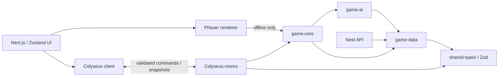

# Architecture and contracts

## Boundaries



No React, Phaser, timers, sockets, database code, or wall-clock access enters the combat engine. A `BattleEngine` instance owns one mutable simulation. `getBattleSnapshot()` returns a detached clone. The same engine is used locally and on the server.

`BattleSession` is the separately tested room-policy layer. Colyseus supplies connection lifecycle and transport. Nest supplies immutable data and temporary identities. They coordinate through shared definitions and contracts; neither service depends on the other's runtime availability.

## Simulation API

```ts
const battle = initializeBattle(
  {
    rules,
    players: ['alice', 'bob'],
    aiTeams: [1], // offline opponent only; online leaves this empty
  },
  seed,
);
battle.submitTeamSelection('alice', ['pikachu', 'squirtle']);
battle.submitTeamSelection('bob', ['bulbasaur', 'charmander']);
battle.startBattle();
battle.updateBattle(1 / 60);
const snapshot = battle.getBattleSnapshot();
const result = battle.determineWinner();
battle.resetBattle();
```

`resetBattle()` retains submitted teams and restores the RNG seed, identifiers, counters, and selection phase. Inputs are validated before simulation. Delta values must be finite and between 0 and 0.25 seconds. An accumulator advances only 1/60-second ticks. Both runtimes clamp excessively delayed frames to avoid unbounded catch-up.

The coordinate system uses **feet at `y=0`**, with positive height above the ground. Rendering maps this to `screenY=520-y`. X boundaries are 55–1145 in a 1200-unit arena. Every arena uses the same flat collision geometry.

Each tick:

1. Advance cooldowns, energy, statuses, and action durations.
2. Choose a target and run AI when a species/difficulty reaction timer allows it.
3. Advance casts and fire configured animation events.
4. Apply movement, acceleration, gravity, ground collision, and boundaries.
5. Separate overlapping bodies; sweep projectile segments through target hitboxes.
6. Resolve damage/status effects, fainting, reserve deployment, and victory.

Skills consume energy and start cooldown on commitment, including interrupted casts. The cast's `events` specify exact hit/projectile/buff timestamps. Melee active windows track already-hit targets; projectiles stop on the first valid collision. Same-team hits are ignored. Each offensive move has its own damage, geometry, timing, energy, cooldown, statuses, knockback, and AI use conditions. Quick Attack and Volt Tackle also drive real movement during their startup.

Damage is rounded and clamped to a minimum of one:

```text
base × (0.72 + attack / 70) × 100 / (100 + defense)
     × elementalMultiplier × (1 - guardReduction)
```

Guard and shield use the stronger reduction; they do not stack. Invulnerability skips damage entirely. Burn and Leech Seed tick once per second. Slow reduces movement speed. Stun interrupts casting. Reserve Pokémon regenerate energy, and deployment clears residual statuses. Switching requires low health, an available healthy reserve, and a swap cooldown; faint replacement never depends on the optional switching rule.

Timed scoring sums normalized remaining HP across the entire roster, then compares surviving count. Elimination is checked before time. Offline pause stops simulation ticks; online disconnection freezes the whole authoritative battle until reconnect or forfeit.

## AI

The `game-ai` package receives a fighter, snapshot, seeded RNG, and difficulty. It returns a movement, skill, dodge, or wait decision. It never directly deals damage.

The explicit states are Idle, FindTarget, Chase, MaintainDistance, Retreat, Attack, CastSkill, Dodge, Jump, Guard, Recover, Stunned, and Fainted. The engine handles transitions that depend on physics or attack completion; the utility layer handles tactical decisions.

Decisions consider distance, facing, enemy windup, projectile relative velocity/collision time, current HP, cooldowns, energy, boundaries, nearby allies, preferred range, and elemental matchups. Defensive reactions are checked only on think intervals. Probability and noisy timing prevent perfect evasion. Jump height is predicted ballistically; crouch tests the projectile's lower edge against a reduced hitbox. Dash requires space and has a short invulnerability window. Guard is preferred by Squirtle. Bulbasaur favors retreat and zoning; Charmander pursues aggressively; Pikachu reacts and dashes quickly.

Species stats and balance values live in `game-data`, not React. Default player AI is Normal. Offline difficulty modifies the opposing team's reaction delay, accuracy, and aggression. Online both sides receive identical difficulty tuning.

## Rendering and accessibility

Phaser is imported dynamically inside a client effect and uses its Canvas renderer for this sprite/path-only scene. This avoids the software-WebGL readback stalls observed in browser verification. The arena scene and Phaser module never execute during Next server rendering. Each mounted canvas has one game instance; cleanup destroys its scene, textures, canvas, audio nodes, subscriptions, and listeners. A disposed flag guards late imports during React Strict Mode transitions.

SVG sprite sheets contain 15 rows × 6 frames. Phaser plays actual frames for each state. The source generator changes limbs, body pose, eyes, tail, and shell rotation rather than relying on CSS position changes. CSS frame stepping is used only for the menu preview. Arena backgrounds have four layers, mild camera parallax, and atmospheric particles.

The offline engine advances from the render loop. Online rendering interpolates from previous to current snapshot over a 50 ms window; it never simulates or predicts damage. React HUD updates are throttled to 10 Hz. Duplicate lobby snapshots are ignored. Simulation events carry monotonic IDs to avoid duplicate VFX/audio.

Health, energy, cooldowns, names, battle events, and outcomes also appear as HTML outside the canvas. Controls have keyboard focus and accessible labels. Settings and results use Radix Dialog with focus trapping. Reduced-motion preferences remove decorative motion; audio is opt-in. Further screen-reader and real-device accessibility review remains recommended.

## Online protocol

Clients send only these operations:

| Message   | Payload        | Rules                                                             |
| --------- | -------------- | ----------------------------------------------------------------- |
| `rules`   | `MatchRules`   | Host only, lobby phase, strict Zod schema; clears teams/readiness |
| `team`    | `SpeciesId[]`  | Exact team size, valid species, duplicate policy, lobby phase     |
| `ready`   | boolean        | Complete team required; both connected players start countdown    |
| `rematch` | literal `true` | Finished match; both connected players must vote                  |
| `sync`    | ignored        | Requests current lobby and battle snapshots                       |

Unknown messages receive an error. There are no movement, damage, RNG seed, winner, or health-write messages. Every accepted mutation must identify a current room member. Room message token buckets allow 20 initial operations and replenish 5/second, with an additional Colyseus limit of 30 messages/second. HTTP matchmaking limits POST operations to 30/minute/IP. The API allows 120 requests/minute/IP. These are in-memory initial-release limits, not a distributed protection service.

The server chooses the seed and ticks at 60 Hz using an elapsed-time accumulator. It publishes full MessagePack-encoded lobby/battle messages at 20 Hz. Each snapshot includes all units, cooldowns, statuses, current casts, projectiles, a bounded last-100 event list, tick number, and result. Clients can read these values but have no authority to change them.

Private rooms do not appear in public discovery. Their unguessable Colyseus room ID is the invitation code; it is not account authentication. Sessions are temporary and reconnection tokens are stored only in sessionStorage. A 30-second reconnection reservation survives unexpected socket loss, and definitive departure forfeits an active match. Lobby departure transfers host ownership. Finished matches require both original players for a rematch; a new opponent requires a new room.

Empty rooms auto-dispose. Idle lobby/finished rooms expire after ten minutes; a battle gets a one-hour inactivity ceiling, and every room has a two-hour hard lifetime. Room timers are owned by Colyseus and cleaned up on disposal. A server restart loses all rooms and clients receive an unavailable-room state.

## API

| Method | Path           | Response                                                        |
| ------ | -------------- | --------------------------------------------------------------- |
| GET    | `/health`      | Service health/version                                          |
| GET    | `/config`      | Default rules, options, tick/snapshot rates                     |
| GET    | `/pokemon`     | Four full typed definitions                                     |
| GET    | `/pokemon/:id` | Definition, or 404                                              |
| GET    | `/arenas`      | Three arena definitions                                         |
| POST   | `/identity`    | Random temporary UUID and suggested lifetime; no account stored |

The API and room server use an explicit frontend-origin allowlist. The temporary identity endpoint is stateless; its advertised lifetime is informational rather than an authorization token. Multiplayer authorization derives from actual room membership.

## Persistence and deployment extension

Add MongoDB/Mongoose later in the Nest service behind a `MatchResultRepository` adapter. Persist a result record (seed, rules, roster, outcome, simulation version) after the server finishes a match. Do not inject database models into `game-core` or `game-ai`. Saved settings, profiles, and progression belong in API services. Keep active simulation in memory and attach durable result persistence at the room boundary.

Multi-process deployment additionally needs a shared Colyseus presence/driver and routing. TLS termination must support WebSockets; set `NEXT_PUBLIC_GAME_SERVER_URL` to the reachable HTTPS/WSS origin and rebuild the frontend. This repository does not provision public hosting or claim multi-node resilience.

## Version verification

Resolved and tested versions are locked by `package-lock.json`. The implementation uses Next 16.4.2 / React 19.3.1, Phaser 3.90.0, Tailwind 4.3.3, Zustand 5.0.15, Nest 11.2.7, Colyseus core 0.17.52 / SDK 0.17.43 / WebSocket transport 0.17.13, Zod 4.6.7, TypeScript 5.9.3, Vitest 4.1.12, and Playwright 1.64.1. Phaser 3 and Nest 11 were deliberately retained as stable compatible release lines; this project does not require migrating to their newer majors.

Official references consulted on October 18, 2026:

- [Next App Router installation](https://nextjs.org/docs/app/getting-started/installation), plus the installed version's bundled client-component, lazy-loading, CSS, and transpilation docs.
- [Phaser 3 release archive](https://phaser.io/download/phaser3) and installed Phaser declarations.
- [Nest migration requirements](https://docs.nestjs.com/migration-guide) and installed Nest 11 packages.
- [Colyseus rooms](https://docs.colyseus.io/room), [reconnection lifecycle](https://docs.colyseus.io/room/reconnection), and installed 0.17 lifecycle/transport declarations. Current online docs describe newer features too; only installed 0.17 APIs are used here.
- [shadcn/ui Next setup](https://ui.shadcn.com/docs/installation/next), [Tailwind PostCSS](https://tailwindcss.com/docs/installation/using-postcss), [Zod](https://zod.dev/), [Vitest](https://vitest.dev/guide/), and [Playwright](https://playwright.dev/docs/intro).
